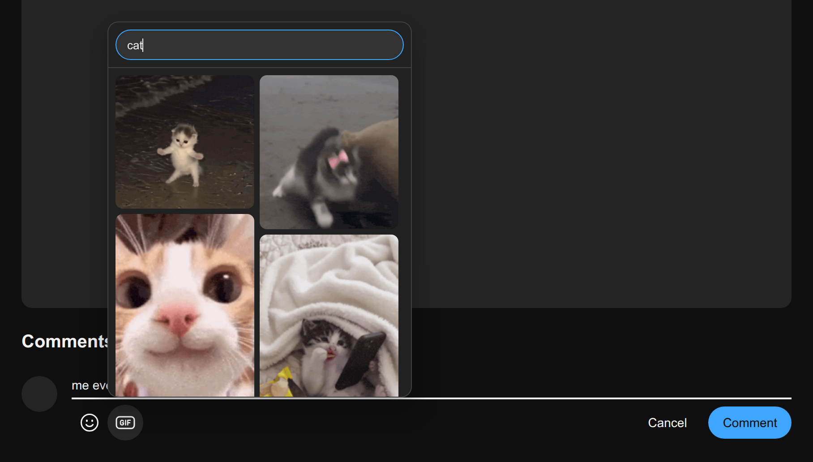
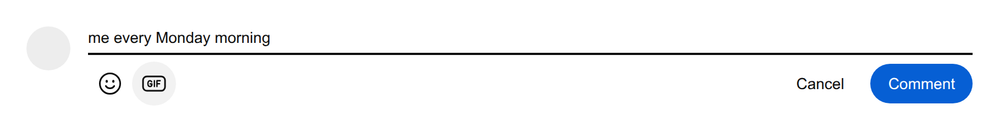

  

<h1 align="center">Desktop GIFs</h1>

  <strong>Post GIFs in YouTube comments and replies from a desktop browser.</strong>

  
  
  
  
  

  <a href="#install">Install</a> ·
  <a href="#use">Use</a> ·
  <a href="#troubleshooting">Troubleshooting</a> ·
  <a href="#limits">Limits</a> ·
  <a href="#how-it-works">How it works</a> ·
  <a href="#privacy">Privacy</a>

  

YouTube's mobile app can attach a GIF to a comment; the desktop site has no button for it. Desktop GIFs adds one, next to the emoji button:

  

- **Everyone sees your GIF.** It is posted as an ordinary YouTube GIF comment, so viewers do not need the extension.
- **Three clicks.** Open a comment box, click **GIF**, click the one you want.
- **Search or paste.** Search Tenor, or paste a Tenor link.
- **Nothing to set up.** No account, no API key, no tracking.

The screenshots show the extension's own interface on a test page that stands in for YouTube's comment box.

## Install

Desktop GIFs is not on the Chrome Web Store or addons.mozilla.org yet, so it is loaded from a folder. The same folder works in both browsers.

  

### Chrome

1. [Download the ZIP](https://github.com/rayytor/desktop_gifs/archive/refs/heads/main.zip) and unzip it.
2. Open `chrome://extensions` and turn on **Developer mode** (top right).
3. Click **Load unpacked** and choose the `extension` folder inside the unzipped folder.

YouTube tabs that are already open get the button without a refresh.

Edge, Brave and other Chromium browsers should work the same way but are untested.

### Firefox

1. [Download the ZIP](https://github.com/rayytor/desktop_gifs/archive/refs/heads/main.zip) and unzip it.
2. Open `about:debugging#/runtime/this-firefox`.
3. Click **Load Temporary Add-on…** and choose `manifest.json` in the `extension` folder.

YouTube tabs that are already open get the button without a refresh.

> [!NOTE]
> Firefox removes an add-on loaded this way when it closes. That is how Firefox treats every temporary add-on. Repeat steps 2 and 3 after a restart.

## Use

1. On a video or a Short, click **Add a comment…** or **Reply**.
2. Click the **GIF** button next to the emoji button.
3. Click a GIF. **It is posted straight away**, there is no preview step.

Anything you typed in the comment box is posted together with the GIF.

The picker opens with Tenor's featured GIFs. To find another one:

- type to search Tenor, or
- paste a Tenor link: a `tenor.com/view/…` page, a `media.tenor.com` file, or a bare Tenor ID.

| Key | What it does |
| --- | --- |
| <kbd>Enter</kbd> | Posts the GIF when the picker shows exactly one result, as it does after pasting a link |
| <kbd>Esc</kbd> | Closes the picker |

## Troubleshooting

| What you see | What to do |
| --- | --- |
| No **GIF** button in the comment box | Refresh the YouTube tab. |
| "Not ready in this tab yet" | The tab was open before the install and the extension is still checking that it can post from it. Try again in a few seconds, or refresh the tab. |
| "The page hook is not running" or "The extension was reloaded" | Refresh the YouTube tab. |
| "Press Comment to send the GIF" | YouTube did not send the comment by itself. Press its Comment button. |
| The post fails | Nothing is published and your text stays in the box. Try again. |
| Search finds nothing in Firefox | Open `about:addons`, select Desktop GIFs, and check under **Permissions** that access to `tenor.com` is on. |
| Chrome lists a warning about `background.scripts` | Ignore it. That key is there for Firefox. |

## Limits

- **Unofficial.** This project is not affiliated with YouTube, Google or Tenor. It sends a field that YouTube's desktop site does not use itself, so it can stop working whenever YouTube changes something, and using it is at your own risk under YouTube's Terms of Service.
- **Tenor only.** YouTube's GIF comments take Tenor GIFs. Tenor closed its public API in June 2026, so search results are read from Tenor's web pages and will break if those pages change. Pasting a link keeps working without search.
- **GIFs only.** Stickers and still images are left out of the results.
- **New comments and replies only.** You cannot add a GIF while editing a comment or writing a channel post.

## How it works

When you pick a GIF, the content script adds a one-time marker to the comment box and presses YouTube's own Comment button. YouTube builds and signs the request as usual. The main-world script catches that request, removes the marker and adds the GIF's Tenor ID. A marker that cannot be turned into a GIF is blocked, so it never appears as comment text.

| File | Runs in | Job |
| --- | --- | --- |
| `src/content.js`, `src/content.css` | YouTube page, isolated world | Adds the GIF button and the picker |
| `src/main.js` | YouTube page, main world | Rewrites the comment request so it carries the GIF |
| `src/sw.js` | Service worker (background script in Firefox) | Fetches search results from tenor.com; on install, adds the two scripts above to YouTube tabs that are already open |

There is no build step and there are no dependencies: the `extension` folder is the extension.

## Privacy

- **Two sites, nothing else:** `youtube.com`, where it adds the button, and `tenor.com`, for search.
- **Nothing collected.** No analytics, no storage, no account.
- **Search goes to Tenor without your cookies**, and GIF previews load from Tenor's media servers.
- **Your YouTube credentials are never read.** YouTube's own page sends the comment.

## License

Copyright (C) 2026 rayytor

This program is free software: you can redistribute it and/or modify it under the terms of the GNU General Public License as published by the Free Software Foundation, version 3. It is distributed without any warranty. See [LICENSE](LICENSE).
